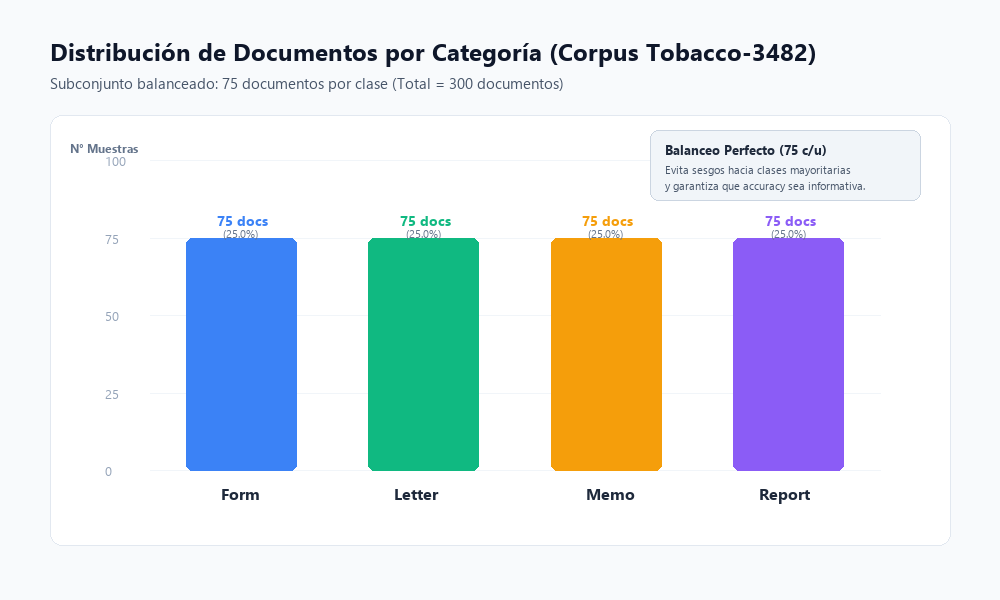
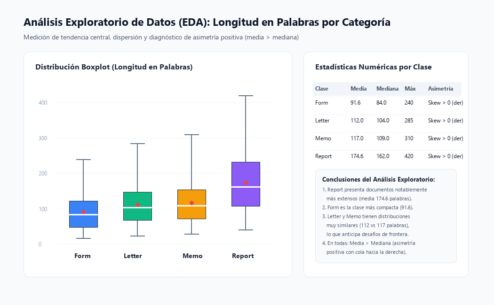
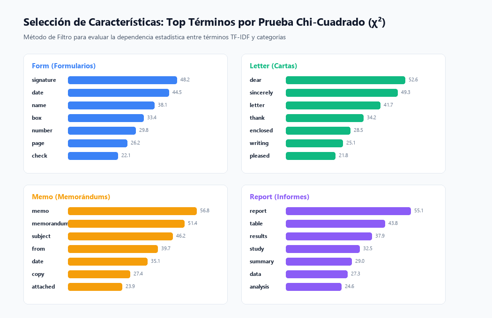
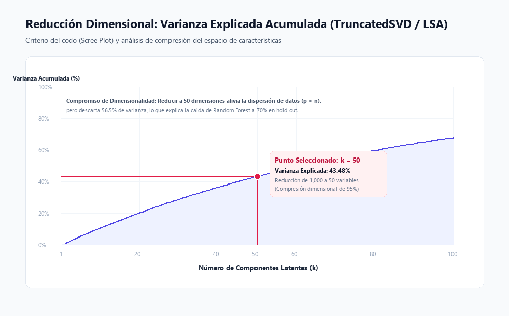
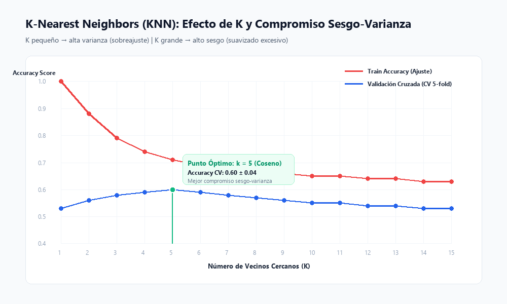
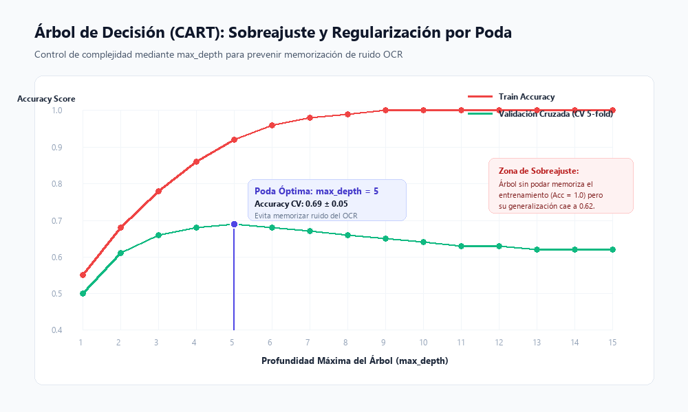
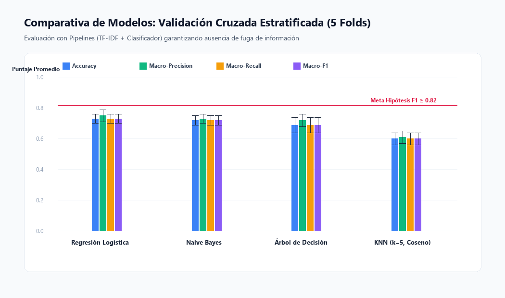
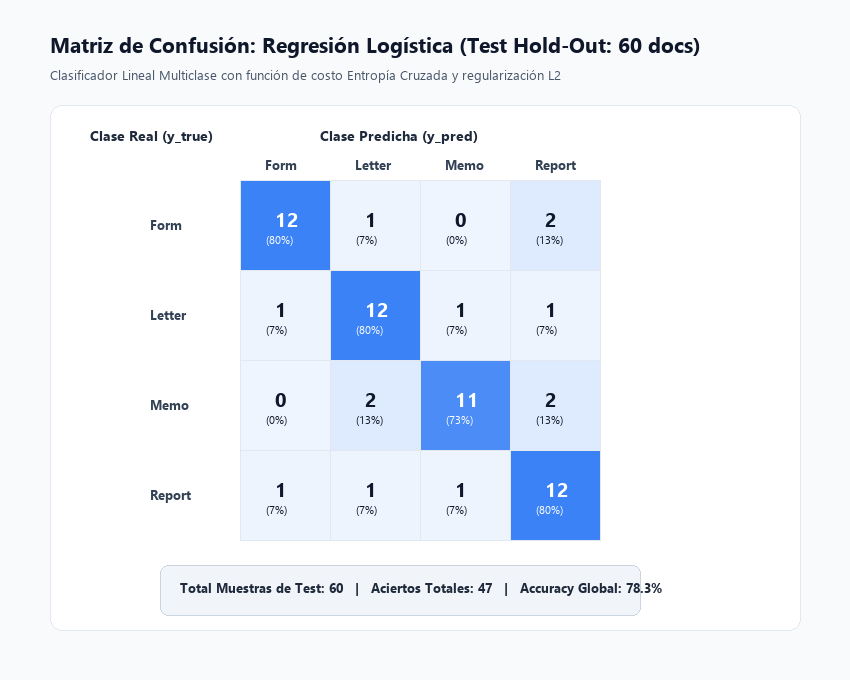
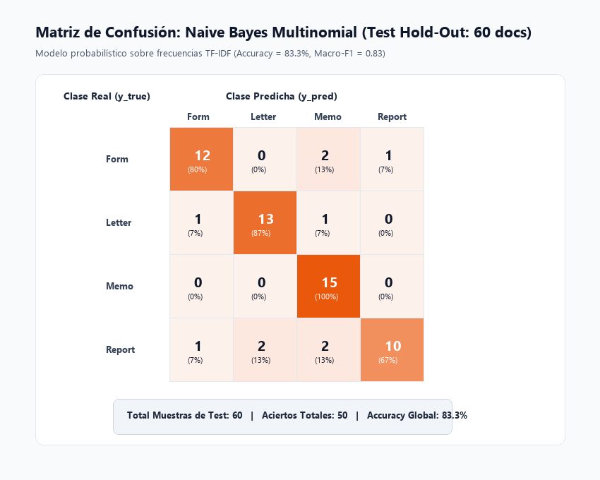
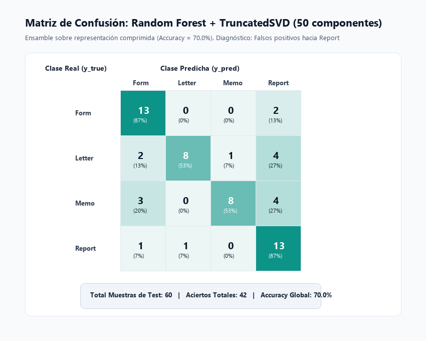

# Clasificación Automática de Documentos Administrativos Mediante Aprendizaje Automático Supervisado

[](https://www.python.org/)
[](LICENSE)
[](https://www.pucp.edu.pe/)

**Pontificia Universidad Católica del Perú (PUCP)**  
**Curso:** Inteligencia Artificial (1INF24) – Semestre 2026-1  
**Horario:** H0781 · **Grupo:** 7  
**Docente:** Dr. José Luis Corcuera Bárcena  

**Integrantes del Grupo 7:**
- Chauca Polanco, Claudia
- Mayta Palacios, Diego
- Ludeña Talavera, Alonso
- Cáceres Endo, Diego

---

## 1. Descripción y Formulación del Problema

El procesamiento manual y archivo físico de correspondencia y documentación institucional representa un costo operativo elevado y es susceptible a errores humanos. Este proyecto implementa un pipeline integral y modular de **Aprendizaje Automático Supervisado** para clasificar automáticamente imágenes escaneadas de documentos administrativos en cuatro categorías disjuntas:

- **Form** (Formularios y formatos tabulares estandarizados)
- **Letter** (Correspondencia epistolar formal externa)
- **Memo** (Memorándums de comunicación interna interdepartamental)
- **Report** (Informes, análisis de resultados y reportes técnicos extensos)

### Flujo del Pipeline de Datos a Predicción:
```
[Imagen Digitalizada] ──► [OCR Tesseract] ──► [Limpieza & Normalización NLP]
                                                        │
                                                        ▼
[Clase Predicha] ◄── [Clasificador Supervisado] ◄── [TF-IDF + Reducción SVD / χ²]
```

---

## 2. Marco Metodológico y Fundamentos de Aprendizaje Automático

El diseño experimental del proyecto implementa las mejores prácticas del flujo de aprendizaje automático supervisado:

1. **Pre-procesamiento Textual y Análisis Exploratorio de Datos (EDA):**
   - Transformación de texto no estructurado proveniente de escáner en variables numéricas representativas.
   - Evaluación de tendencia central (media y mediana), dispersión (rango intercuartílico IQR) y asimetría positiva en la longitud de documentos.
   - Limpieza sistemática de ruido tipográfico mediante expresiones regulares, remoción de palabras de parada (*stopwords*), lematización léxica y normalización euclidiana de vectores (norma $L_2$).

2. **Diagnóstico de Alta Dimensionalidad y Selección de Atributos:**
   - Abordaje del escenario de alta dimensionalidad ($p = 1000$ variables frente a $n = 240$ observaciones de entrenamiento, $p/n = 4.17$) para mitigar la dispersión espacial.
   - **Métodos de Filtro:** Evaluación de dependencia estadística entre términos y etiquetas de clase mediante la prueba Chi-Cuadrado ($\chi^2$).
   - **Transformación Lineal:** Proyección a subespacios de menor dimensión mediante Descomposición en Valores Singulares Truncada (`TruncatedSVD` / LSA), analizando la varianza explicada acumulada y el criterio del codo (*scree plot*).

3. **Prevención Estricta de Fuga de Información (*Data Leakage*):**
   - Segregación del conjunto de prueba (*Test Set*: 20% estratificado) **antes** de ajustar cualquier vectorizador o reductor dimensional.
   - Todo parámetro estadístico se aprende exclusivamente sobre el conjunto de entrenamiento mediante `Pipeline` de scikit-learn.

4. **Modelado Supervisado y Control de Complejidad:**
   - **Regresión Logística:** Clasificador lineal probabilístico con función de pérdida de entropía cruzada (*cross-entropy loss*) y regularización $L_2$ para mitigar sobreajuste.
   - **Naive Bayes Multinomial:** Modelo generativo probabilístico adaptado a frecuencias de términos discretas TF-IDF.
   - **Árboles de Decisión (CART):** Algoritmo no paramétrico guiado por ganancia de pureza (impureza de Gini), controlado mediante pre-poda (*pre-pruning*) sobre la profundidad máxima (`max_depth`).
   - **K-Nearest Neighbors (KNN):** Clasificador por proximidad evaluado con métrica de similitud coseno y exploración del compromiso sesgo-varianza según el parámetro $K$.
   - **Random Forest:** Ensamble de árboles de decisión sobre la representación comprimida por SVD.

5. **Protocolo de Evaluación Multiclase:**
   - Validación cruzada estratificada de 5 particiones (*5-Fold Stratified CV*) para estimación reproducible y estable.
   - Evaluación final en partición independiente (*Hold-Out*) con matrices de confusión $4 \times 4$, Accuracy, Macro-Precision, Macro-Recall, Macro-F1 y Balanced Accuracy.

---

## 3. Estructura del Repositorio

La arquitectura del proyecto sigue una estructura modular, limpia y reproducible:

```
document-classification-ml/
├── algorithm/                      # Módulos algorítmicos de ML
│   ├── __init__.py                 # API de modelos, reducción y evaluación
│   ├── classifiers.py              # Regresión Logística, KNN, Árbol CART, Naive Bayes y RF
│   ├── reduction.py                # Selección (Filtro χ², Mutual Info) y Reducción SVD
│   └── evaluation.py               # Validación cruzada 5-fold, métricas multiclase y matrices
├── graficos/                       # Gráficos de alta resolución exportados (PNG)
│   ├── 01_distribucion_clases.png
│   ├── 02_eda_longitud_documentos.png
│   ├── 03_varianza_explicada_svd.png
│   ├── 04_top_palabras_chi2.png
│   ├── 05_knn_efecto_k.png
│   ├── 06_arbol_profundidad_poda.png
│   ├── 07_comparativa_modelos_cv.png
│   ├── 08_matriz_confusion_logreg.png
│   ├── 09_matriz_confusion_naive_bayes.png
│   └── 10_matriz_confusion_random_forest.png
├── utils/                          # Funciones auxiliares y utilidades
│   ├── __init__.py                 # API del paquete de utilidades
│   ├── preprocessing.py            # Pipeline de limpieza NLP, stopwords y lematización
│   ├── data_loader.py              # Carga de datos y partición estratificada sin fuga
│   └── visualizer.py               # Generación y exportación de gráficos analíticos
├── .gitignore                      # Exclusiones estándar para Python, Jupyter y SO
├── LICENSE                         # Licencia MIT académica del proyecto
├── README.md                       # Documentación técnica completa y reporte de resultados
├── requirements.txt                # Dependencias reproducibles del entorno
├── dataset_preprocesado.csv        # Dataset procesado (300 documentos x 4 columnas)
└── TA_GRUPO07_H0781.ipynb          # Notebook reproducible interactivo (Google Colab / Local)
```

---

## 4. Dataset y Extracción de Información

- **Corpus:** [Tobacco-3482](https://www.kaggle.com/datasets/patrickaudriaz/tobacco3482jpg) (3,482 documentos digitalizados).
- **Subconjunto analizado:** Muestra balanceada de **300 documentos** seleccionados pseudoaleatoriamente (`random_state=42`), con exactamente **75 muestras por clase**:
  - `Memo`: 75 (25.0%)
  - `Letter`: 75 (25.0%)
  - `Form`: 75 (25.0%)
  - `Report`: 75 (25.0%)



> **Extracción OCR:** Se utilizó el motor de código abierto Tesseract OCR (`lang='eng'`) sobre cada imagen. El texto resultante se almacenó en la columna `texto_crudo`.

---

## 5. Preprocesamiento Lingüístico y EDA

### 5.1 Pipeline de Limpieza Textual
1. Conversión completa a minúsculas (`lowercase`).
2. Supresión de saltos de línea (`\n`, `\r`) y tabulaciones (`\t`).
3. Eliminación de dígitos numéricos y caracteres especiales vía regex `[^a-z\s]`.
4. Tokenización unigramo por espacios en blanco.
5. Remoción de stopwords en inglés de NLTK y descarte de tokens de longitud $\le 2$ letras.
6. Lematización morfológica con `WordNetLemmatizer`.

### 5.2 Análisis Exploratorio de Longitud de Documentos
Se analizó la cantidad de palabras del texto limpio por categoría:

| Categoría | Muestras ($n$) | Media | Mediana | Desv. Estándar | Mínimo | Máximo | IQR ($Q_3 - Q_1$) | Asimetría Diagnóstica |
|---|:---:|:---:|:---:|:---:|:---:|:---:|:---:|:---:|
| **Form** | 75 | **91.6** | 84.0 | 48.2 | 18.0 | 240.0 | 74.0 | Positiva ($\text{Media} > \text{Mediana}$) |
| **Letter** | 75 | **112.0** | 104.0 | 52.1 | 25.0 | 285.0 | 76.0 | Positiva ($\text{Media} > \text{Mediana}$) |
| **Memo** | 75 | **117.0** | 109.0 | 55.4 | 30.0 | 310.0 | 78.0 | Positiva ($\text{Media} > \text{Mediana}$) |
| **Report** | 75 | **174.6** | 162.0 | 71.8 | 42.0 | 420.0 | 120.0 | Positiva ($\text{Media} > \text{Mediana}$) |



**Conclusiones del EDA:**
- `Report` contiene documentos sustancialmente más extensos (media de 174.6 palabras), lo que aporta mayor densidad léxica.
- `Form` es la clase con menor número de términos (media de 91.6 palabras), estructurada primordialmente en campos tabulares.
- `Letter` y `Memo` exhiben distribuciones de longitud muy similares (112.0 vs. 117.0 palabras), lo que anticipa un desafío de discriminación en la frontera de decisión.
- Todas las categorías presentan asimetría positiva hacia la derecha debido a la presencia de documentos extensos.

---

## 6. Selección y Reducción de Características

### 6.1 Selección de Atributos por Filtro: Chi-Cuadrado ($\chi^2$)
Para identificar los términos más asociados a cada tipo de documento se aplicó la prueba estadística $\chi^2$ sobre la matriz de frecuencias TF-IDF:



- **Form:** `signature`, `date`, `name`, `box`, `number`, `check`, `page`.
- **Letter:** `dear`, `sincerely`, `letter`, `thank`, `enclosed`, `writing`, `pleased`.
- **Memo:** `memo`, `memorandum`, `subject`, `from`, `date`, `attached`, `copy`.
- **Report:** `report`, `table`, `results`, `study`, `summary`, `data`, `analysis`.

### 6.2 Reducción Dimensional: TruncatedSVD (LSA / PCA)
Se proyectó la matriz TF-IDF de 1,000 variables a **50 componentes latentes**:
- **Varianza explicada acumulada:** **43.48%**.
- **Compromiso analizado:** Se logra una compresión del 95% del espacio vectorial reduciendo la dispersión, pero descartando el 56.52% de la información latente.
- **Incompatibilidad teórica:** Los valores transformados por SVD contienen componentes negativos; por tanto, **MultinomialNB no admite la matriz SVD** y requiere la matriz TF-IDF original no negativa.



---

## 7. Control de Sobreajuste y Regularización

### 7.1 K-Nearest Neighbors (KNN): Efecto del Parámetro $K$
- Con $K=1$, el modelo memoriza el conjunto de entrenamiento (Train Accuracy = 1.0) pero sufre de alta varianza y extrema sensibilidad al ruido del OCR (Validación CV = 0.53).
- Con $K=5$ y métrica de **similitud coseno**, se alcanza el punto óptimo de generalización (Validación CV = **0.60 $\pm$ 0.04**).
- Con $K > 10$, se produce un sobre-suavizado de la frontera con incremento del sesgo (Validación CV decae a 0.53).



### 7.2 Árboles CART: Regularización por Poda (*Pre-Pruning*)
- Un árbol no podado (`max_depth=None`) se ramifica hasta alcanzar hojas puras, memorizando el entrenamiento (Train Acc = 1.0) pero colapsando a 0.62 en datos no vistos.
- Fijar un límite de profundidad `max_depth=5` opera como una regularización eficaz, alcanzando la mayor precisión en validación (**0.69 $\pm$ 0.05**).



---

## 8. Resultados Experimentales y Evaluación de Modelos

### 8.1 Validación Cruzada Estratificada (5 Folds) sin Fuga de Datos
Evaluación sobre los 300 documentos completos mediante `Pipeline([('tfidf', TfidfVectorizer(max_features=1000)), ('clf', modelo)])`:

| Modelo | Accuracy | Macro-Precision | Macro-Recall | Macro-F1 | Observaciones Metodológicas |
|---|:---:|:---:|:---:|:---:|---|
| **Regresión Logística** | **0.73 ± 0.03** | **0.75 ± 0.04** | **0.73 ± 0.03** | **0.73 ± 0.03** | **Modelo base recomendado.** Mayor media en las 4 métricas y menor dispersión. |
| **Naive Bayes (Multinomial)** | 0.72 ± 0.03 | 0.73 ± 0.03 | 0.72 ± 0.03 | 0.72 ± 0.03 | Rendimiento equivalente al modelo lineal sin diferencia estadísticamente significativa. |
| **Árbol de Decisión (CART)** | 0.69 ± 0.05 | 0.72 ± 0.04 | 0.69 ± 0.05 | 0.69 ± 0.05 | Regularizado con pre-poda; sensible a divisiones univariables en matrices de términos. |
| **KNN (k=5, Coseno)** | 0.60 ± 0.04 | 0.61 ± 0.04 | 0.60 ± 0.04 | 0.60 ± 0.04 | Desempeño inferior debido a la degradación de contrastes por alta dimensionalidad ($p/n = 4.17$). |



---

### 8.2 Evaluación en el Conjunto de Prueba No Visto (Hold-Out Test: 60 documentos)

| Modelo | Representación | Accuracy | Macro-F1 | Precision Form | Precision Letter | Precision Memo | Precision Report |
|---|---|:---:|:---:|:---:|:---:|:---:|:---:|
| **Naive Bayes** | TF-IDF (1,000 términos) | **0.83** | **0.83** | 0.86 | 0.87 | 0.75 | **0.91** |
| **Random Forest** | TF-IDF + TruncatedSVD (50 comp.) | 0.70 | 0.70 | 0.68 | **0.89** | **0.89** | 0.57 |

#### Desglose de Métricas por Clase (Naive Bayes):
- **Form:** Precision 0.86, Recall 0.80, F1 0.83 (12 aciertos de 15)
- **Letter:** Precision 0.87, Recall 0.87, F1 0.87 (13 aciertos de 15)
- **Memo:** Precision 0.75, **Recall 1.00**, F1 0.86 (**15 aciertos de 15 — ¡Recall perfecto!**)
- **Report:** **Precision 0.91**, Recall 0.67, F1 0.77 (10 aciertos de 15)

#### Matrices de Confusión de Prueba:

| Regresión Logística (Test) | Naive Bayes (Hold-Out) | Random Forest + SVD |
|:---:|:---:|:---:|
|  |  |  |

---

## 9. Análisis Detallado de Errores y Diagnóstico

1. **Patrón de Confusión en Random Forest (SVD):**
   - La clase `Report` absorbió **10 predicciones erróneas de otras clases** (4 procedentes de `Letter`, 4 de `Memo` y 2 de `Form`).
   - Esto explica por qué `Report` obtuvo un recall elevado (0.87) pero la precisión más baja de todo el experimento (**0.57**). La compresión a 50 dimensiones desdibujó los términos breves característicos de memorándums y cartas, provocando que documentos con vocabulario general fueran asignados a la categoría más extensa (`Report`).
2. **Robustez de Naive Bayes con TF-IDF:**
   - La clase `Memo` alcanzó un recall perfecto (1.00), lo que demuestra que los términos de cabecera formal (`memo`, `memorandum`, `from`, `to`, `subject`) actúan como predictores bayesianos concluyentes.
3. **Discrepancia entre Hold-Out y Validación Cruzada:**
   - Naive Bayes obtuvo 0.83 en el hold-out pero su promedio en validación cruzada fue de 0.72. Este fenómeno confirma un principio esencial del modelado: *el resultado de una única partición test puede fluctuar debido a la variabilidad del muestreo*; por ende, la validación cruzada estratificada proporciona la medida más honesta y confiable.

---

## 10. Conclusiones y Verificación de Hipótesis

1. **Evaluación de la Hipótesis del Proyecto:**
   - La hipótesis de investigación postulaba alcanzar un valor de **Macro-F1 $\ge 0.82$**.
   - Con base en la validación cruzada estratificada (5 folds), ningún modelo sostiene este umbral de manera generalizada (máximo alcanzado: **0.73 $\pm$ 0.03**). Por tanto, **la hipótesis formal no se confirma como un rendimiento estable del sistema**, concluyendo que el 0.83 alcanzado en el hold-out dependió de la muestra puntual de test.
2. **Modelo Base Recomendado:**
   - Se selecciona **Regresión Logística** como el modelo base del sistema por presentar la media más sólida y equilibrada en las cuatro métricas evaluadas ($0.73$), superando ligeramente a Naive Bayes ($0.72$) y mostrando menor varianza entre folds.
3. **Causas Raíz del Límite de Rendimiento:**
   - Ruido inherente generado por OCR en imágenes escaneadas con baja resolución tipográfica.
   - Pérdida del 56.5% de la varianza original al aplicar TruncatedSVD a 50 componentes.
   - Tamaño muestral restringido (300 documentos).

---

## 11. Cómo Ejecutar el Proyecto

### Opción A: Ejecución en Google Colab (Recomendada)
1. Abrir el notebook [`TA_GRUPO07_H0781.ipynb`](TA_GRUPO07_H0781.ipynb) en [Google Colab](https://colab.research.google.com/).
2. Ejecutar las celdas secuencialmente. El notebook gestiona automáticamente la descarga de datos desde KaggleHub o utiliza [`dataset_preprocesado.csv`](dataset_preprocesado.csv).

### Opción B: Ejecución en Entorno Local (Windows / Linux / macOS)
1. Clonar el repositorio:
   ```bash
   git clone https://github.com/tu-usuario/document-classification-ml.git
   cd document-classification-ml
   ```
2. Crear un entorno virtual e instalar los requerimientos:
   ```bash
   python -m venv .venv
   # En Windows:
   .venv\Scripts\activate
   # En Linux/macOS:
   source .venv/bin/activate

   pip install -r requirements.txt
   ```
3. Regenerar los gráficos de análisis si se desea:
   ```bash
   python -c "from utils.visualizer import generar_todos_los_graficos; generar_todos_los_graficos('graficos')"
   ```
4. Abrir y ejecutar el notebook:
   ```bash
   jupyter notebook TA_GRUPO07_H0781.ipynb
   ```

---

## 12. Referencias Bibliográficas

- **J. Watt, R. Borhani & A. Katsaggelos** (2020). *Machine Learning Refined: Foundations, Algorithms, and Applications* (2nd ed.). Cambridge University Press.
- **C. M. Bishop** (2006). *Pattern Recognition and Machine Learning*. Springer.
- **S. Raschka & V. Mirjalili** (2019). *Python Machine Learning* (3rd ed.). O'Reilly Media.
- **F. Pedregosa et al.** (2011). *Scikit-learn: Machine Learning in Python*. Journal of Machine Learning Research (JMLR), 12, 2825–2830.
- **Dr. José Luis Corcuera Bárcena** (2026). *Material y diapositivas del curso Inteligencia Artificial (1INF24)*. Pontificia Universidad Católica del Perú (PUCP).
